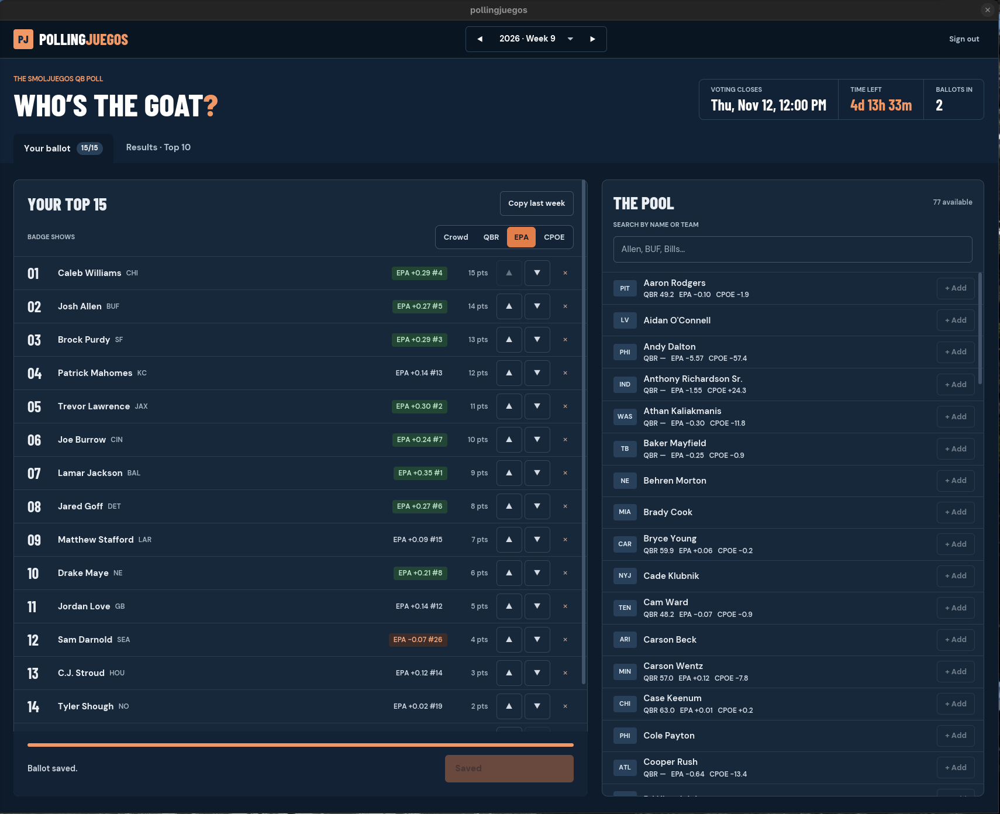
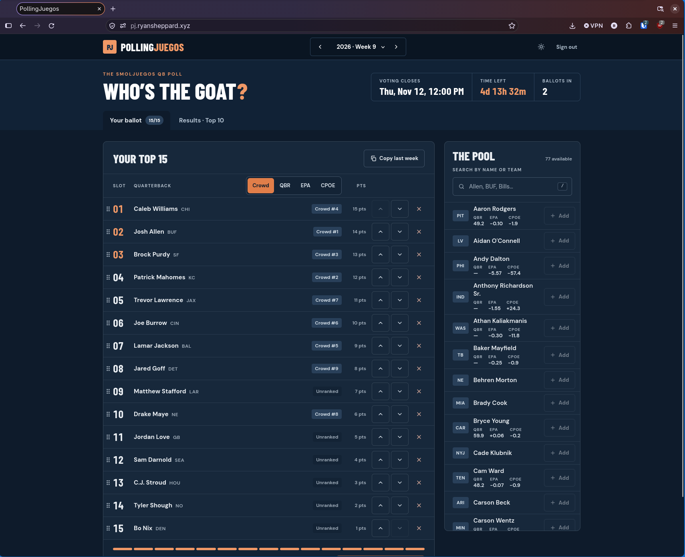

# pollingjuegos

Offers an AP-style poll for NFL QBs. It includes a week by week poll along with QBs and some of their stats like QBR and EPA.

For the most part, this is heavily vibe-coded. This was originally meant to have something quick and easy using Django + django-ninja and Vue to get something going.
However, I have been using this to see how far I can get with an agentic workflow. Professionally, I would invest a lot more time in to planning and thinking through problems.

With this service, I am firing off ideas and testing them to get quick feedback and experience.

## Learnings
* **Claude Design**. It's better than me, someone with no design experience.
* **Rewrite in Rust**. I did guide a lot of the choices and architecture, plus did some coding. But largely let Claude take over. I do not feel great about this as the project is slowly becoming more of a black box. Performance is good though.
* **io_uring**. Really no point in doing this here, but at least the service is fast (60k QPS for reads on 1 CPU/1GB ram). The seccomp profile and potential security downsides make me think epoll is just fine.
* **A desktop application**. It seems to be all the rage right now. Some of types are now shared between the backend, frontend, and desktop application. I can see why the native rewrites are becoming a thing as this would be incredibly tedious otherwise. I chose iced as it had plenty of examples and users. GPUI and Rune are probably fine for this too.
* **DigitalOcean MicroVMs** as a Bazel remote runner. Building the analysis cache was getting slow and these snapshot memory, speeding up CI. The bash script is janky and I bet this might be worth making a real project. It has some pros over being a real self-hosted GitHub Actions runner. Really though, just use BuildBuddy Remote or something.
* **Greptile**. Seems mostly good, but `/code-review` in Claude is hard to beat if you have the tokens to spare.

## Screenshots

